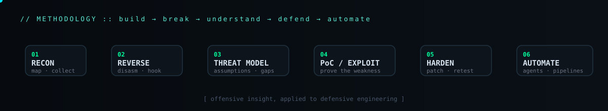

<!-- ░▒▓ lequocthangg · security research profile ▓▒░ -->

<div align="center">
  
</div>

<p align="center">
  
  
  
  
</p>

---

> **Mobile RE & identity-attack researcher.** I test how eKYC, liveness and device-integrity
> controls fail — then build the detections that catch it. I work the whole loop: reverse-engineer
> the app and runtime, measure where authentication over-trusts, reproduce the gap in a controlled
> lab, then design and attack my own mitigation until it holds. Strictly on devices, apps, models
> and environments I own or am authorized to test.
>
> 🔒 **Most of my work lives in private repositories** — targets, PoCs and findings are sensitive.
> This profile describes the *methodology*, not the artifacts. Details available on request, under
> appropriate terms.

<div align="center">
  
</div>

## ▌ Research Tracks

| # | Track | What I actually do |
|---|-------|--------------------|
| `01` | **Reverse Engineering** | Static + dynamic analysis of Android & iOS apps and native code — disassembly, decompilation, runtime tracing and hooking to understand how a binary really works. |
| `02` | **eKYC & Liveness Testing** | Measuring where remote identity-proofing and liveness/face-auth pipelines over-trust — run as controlled attack tests against self-hosted models or sandboxes, framed around PAD (ISO/IEC 30107-3) coverage. Output: detections, not tooling. |
| `03` | **Device Integrity (Root / JB)** | Rooting and jailbreaking as a research platform — `KernelSU-Next`, `roothide`, root-hiding modules — to measure which root/JB/hook signals survive hiding and which detections still hold. |
| `04` | **Custom ROM / Kernel** | Flashing custom ROMs and kernels to keep clean, reproducible test devices — a controlled baseline for every experiment above. |
| `05` | **Injection-Attack Testing (Android + iOS)** | Virtual-camera / camera-pipeline injection PoCs on my own devices — mapping where presentation-attack detection (PAD) stops and injection-attack detection (IAD, CEN/TS 18099) has to take over. |
| `06` | **Defense Engineering & Self-Testing** | The other half of the loop: take every weakness I can prove, build the mitigation, then attack my own fix. Nothing ships in my notes until it survives me. |
| `07` | **AI Agents & Automation** | LLM-driven agents that automate the tedious parts of research — triage, repetitive instrumentation, log/report synthesis — so human time goes to the hard problems. |

<div align="center">
  
</div>

## ▌ Arsenal

<p align="center">
  
  
  
  
  
</p>
<p align="center">
  
  
  
  
  
  
  
</p>
<p align="center">
  
  
  
  
  
  
</p>

## ▌ Current Research

```text
[~] KernelSU-Next ............ kernel-based root; what integrity checks still see
[~] Root / JB detection ...... which signals survive hiding — and how to harden them
[~] Custom ROM + kernel ...... clean, reproducible test devices
[~] eKYC liveness lab ........ PAD vs. injection coverage, self-hosted models only
[~] agent tooling ............ LLM agents that drive the repetitive RE work
```

## ▌ Rules of Engagement

```diff
+ I test only devices, apps and models I own or am explicitly authorized to test.
+ eKYC / liveness work runs on self-hosted models, vendor sandboxes with written
+ permission, or in-scope bug-bounty targets — never live onboarding.
+ Never real identities, live accounts, or real money.
+ Break it to understand it, then build the detection. Coordinated disclosure, always.
```

> I share *methods of thinking* and *defensive lessons* — not turnkey tooling for fraud.

## ▌ Contribution Snake

<div align="center">
  <picture>
    <source media="(prefers-color-scheme: dark)" srcset="https://raw.githubusercontent.com/lequocthangg/lequocthangg/output/snake-dark.svg" />
    <source media="(prefers-color-scheme: light)" srcset="https://raw.githubusercontent.com/lequocthangg/lequocthangg/output/snake.svg" />
    
  </picture>
</div>

<div align="center">
  <br/>
  <code>thang@research:~$ whoami</code> → <b>a builder who breaks things on purpose, so they break less in the wild.</b>
</div>
